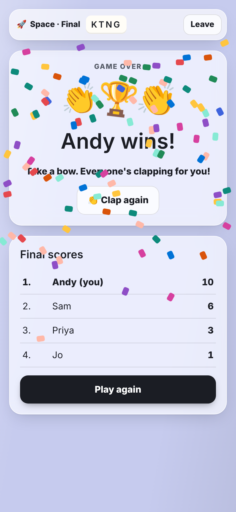

# Brain Jumble

**A fridge-magnet party game for Android phones.** Everyone gets the same silly question and the same pile of word magnets. You've got 75 seconds to stick together the funniest answer you can, then everyone votes, anonymously, for their favourite.

Brain Jumble is a fan-made revival of the much-missed online game *Psychbabble*, rebuilt so friends can play it again on their phones, from anywhere.

  
  
  

## What's new in 1.4

> **Update needed:** 1.4 can't play with older versions. If you're on a previous version, download the latest build from this repo's **[Releases](../../releases/latest)** page and install it over the old one. The app also tells you when a new version is out.

- **AI players.** With fewer than 6 people in a game, 🤖 computer players fill the empty seats. They build answers, vote and score. The host can switch them off in the lobby.
- **10 seconds more to vote** (30 seconds plus 5 per answer, up to 70).
- **New words:** *on* and *under* are always dealt.
- **Weekly scoreboard** on the home screen, starting again every Monday (UTC). Votes won in games with 2 or more real players count; AI players don't.
- **Halo** round the names of the week's top three players, wherever their name appears.

### Earlier: 1.3

- **More joining words, commands and verbs.** Every round deals a spread of connectives (*but*, *because*, *with*, *if*), imperatives (*stop*, *give*, *look*, *shut up*) and plenty more verbs, so you can build proper sentences.
- **15 second "get ready" pause** when starting a game, joining a game and finishing a game, so every phone can catch up first. The host's Play again button unlocks 15 seconds after the winner is shown.
- **Voting fix.** No more being unable to vote or be voted for, or timed out, at the end of a round or game. Moving a magnet as time runs out can't freeze the screen any more, a dropped connection signs you straight back into the game, and slow connections get a few seconds of slack.
- **No more shared wins.** If two players are tied at the top when someone reaches 10, the game plays on with sudden-death rounds until one of them is ahead.
- **Fits any screen.** The layout follows your screen size by itself. Fold phones and tablets use the whole screen (the fridge sits beside your magnets, answers sit side by side), and folding, unfolding or turning your phone no longer restarts the app.

### Earlier: 1.2

- **Over 800 new questions.** Every room now has around 100 (1,221 altogether, up from 407).
- **No more repeated questions.** Each phone remembers what it's seen, even after closing the app, and the host picks questions nobody in the game has had yet.
- **Update alerts.** When a new version comes out, the app tells you and links straight to the download.
- **Updates install over the old app.** No more uninstalling first (after this one-time move to 1.2, see below).
- **Version number** at the bottom of the home screen.

### Earlier: 1.1

- **Punctuation magnets:** `?` `!` `'` `,` `.` `#` `@` `-` `&` in every round.
- **Cheeky words:** mildly rude words like *pee*, *poo*, *bum*, *willy* and *bloody* (nothing too vulgar). Never in Just for Kids, and the host can switch them off.
- **Up to 10 players** per game.
- **First to 10 points wins.**
- **A round of applause** (with confetti) for the winner.

  

Full notes for each version are on the [Releases](../../releases/latest) page.

## Download and install

1. On your Android phone, open this repo's **[Releases](../../releases/latest)** page and tap **Brain Jumble (latest build)**.
2. Download `BrainJumble.apk` and open it.
3. If Android asks, allow installs from your browser ("Install unknown apps"), then tap **Install**.

From version 1.2, new versions install straight over the old one, so updating is the same three steps. When a new version is out, the app pops up a message with a **Get the update** button that brings you here. Everyone playing together should be on the latest version.

**Coming from 1.1 or earlier?** Uninstall the old Brain Jumble first, just this once. Older builds were signed with a different key each time, which is why Android refused to update them. That's fixed from 1.2 on.

## How a game works

1. **Pick a room and start a game.** You get a four-letter room code. Friends type the code, or just tap your game in the same room on their home screen. Starting a game gives everyone a 15 second "Get ready!" countdown, and anyone who joins sits out a 15 second "Getting you in" wait while their phone syncs.
2. **Build your answer.** Everyone sees the same question and the same ~85 magnets, with plenty of joining words, commands and verbs. Tap magnets to stick them on your fridge.
3. **Vote.** All the answers appear without names. Tap your favourite. You can't vote for your own.
4. **See who wrote what.** Names are revealed with the votes, and the next round starts automatically. The first player to reach **10 points** wins, and everyone gives them a round of applause. The final round's results stay up for at least 15 seconds before the winner screen, and the host's **Play again** button unlocks 15 seconds after the winner is shown.

Up to **10 players** can play in one game. With fewer than 6, AI players 🤖 fill the room up to 6 (the host can turn them off).

| Pick a room | Wait in the lobby | Vote for the best |
| :---: | :---: | :---: |
|  |  |  |

### Moving magnets around

- **Tap** a magnet in your pile to add it to your answer.
- **Drag** a placed magnet to move it.
- **Double-tap** a placed magnet, or drag it off the fridge, to put it back.
- **Tap a gap** between magnets to choose where the next word goes.
- The small round magnets (**-s**, **-ing**, **-ed**, **-ly**) stick onto the end of the word before them, so *dance* + *-ing* reads as "dancing".
- The dark round magnets are **punctuation**. `?` `!` `,` `.` stick to the word before, `'` and `-` join the words either side (*dog* + *'* + *s* reads "dog's"), and `#` `@` stick to the word after.
- Changed your mind after sending? Tap **Edit answer** any time before the timer runs out.

### Scoring

| | Points |
| --- | ---: |
| Each vote your answer gets | 1 |
| First to 10 points | Wins the game 🏆👏 |

If two players pass 10 in the same round, the higher score wins. **There are no draws:** if two or more players are level at the top, the game plays on with sudden-death rounds until exactly one of them is ahead.

### Host settings

Whoever starts the game is the host. Before starting, they can change the room, the building time (45, 75 or 120 seconds), and switch cheeky words and AI players on or off. If the host leaves, anyone else in the room can tap **Host this room** to carry on.

## Themed rooms

Each room has its own questions and its own magnets, mixed in with the general word bank. Altogether there are about **1,750 words** and over **1,200 questions**, roughly 100 per room.

Each phone remembers which questions it has seen (even after the app is closed) and shares that with the game, so the host picks a question nobody playing has had before.

| Room | What it's like |
| --- | --- |
| 🧲 **Classic** | The original anything-goes mix |
| 🏛️ **Politics** | Manifestos, U-turns and leaky memos |
| ⚽ **Sport** | Half-time team talks and dodgy refs |
| ☕ **Grown-ups** | Bills, bosses, hangovers and adulting |
| 🎮 **Gaming** | Final bosses, lag and rage quits |
| 👑 **Royalty** | Crowns, corgis and court gossip |
| 🧸 **Just for Kids** | Silly, safe and family-friendly. Only ever deals kid-safe words |
| 🌦️ **Weather** | Drizzle, heatwaves and forecasts |
| 📚 **Books** | Plot twists and overdue library fines |
| 🚀 **Space** | Aliens, rockets and black holes |
| 👻 **Paranormal** | Ghosts, curses and things that go bump |
| 🌶️ **After Dark (18+)** | Cheeky, grown-up questions. Players confirm they're 18 or over first |

| Dark mode | The 18+ check |
| :---: | :---: |
|  |  |

The app follows your phone's light or dark setting automatically, and the fridge door changes colour to match the room you're in.

## Adding your own questions and words

Everything lives in [`www/words.js`](www/words.js):

- Each room in `ROOMS` has a `prompts` list (the questions) and a `words` list (that room's extra magnets).
- More questions for each room are in [`www/prompts-more.js`](www/prompts-more.js), grouped by room. Add new ones to either file; duplicates are dropped automatically.
- The general bank shared by most rooms is in `NOUNS`, `VERBS`, `ADJS` and `WILD`. `CONNECT` (joining words) and `IMPERATIVES` (commands) are dealt every round in every room.
- The mildly rude words are in `CHEEKY`, and the punctuation magnets in `PUNCT`.
- For a magnet with more than one word, join the words with hyphens, like `ice-cream`. It shows on the magnet as "ice cream".

Edit the file on GitHub and commit. A new APK is built automatically within a few minutes, and the screenshots on this page refresh themselves too.

## How it's built

- **`www/`** is the whole game in plain HTML and JavaScript.
  - `www/index.html` holds the screens and game rules.
  - `www/words.js` holds the rooms, questions and word bank.
  - `www/prompts-more.js` holds the extra questions added in 1.2.
  - `www/net.js` connects players through Firebase.
  - `www/update.js` checks GitHub for a newer release when the app opens and shows the update message.
- **Multiplayer** runs on Firebase Realtime Database, on the free plan. The host's phone runs the game and everyone else's phone follows along. Each player only writes their own answer and vote.
- **The Android app** is built by GitHub Actions (`.github/workflows/build.yml`). On every push to `main`, it wraps `www/` with Capacitor, builds the APK, and publishes it as the `latest` release, using `RELEASE_NOTES.md` as the release description.
- **The screenshots** are taken by `.github/workflows/screenshots.yml`, which plays a quick game in a phone-sized browser with three pretend friends.
- `signing/debug.keystore` keeps the signing key the same between builds, so updates install cleanly. `tools/configure-android.mjs` tells the Android build to use it, gives each build a higher version code, and sets the app up for foldables and tablets (resizable window, no restart when the screen changes shape). The build fails if the APK isn't signed with it. It's a standard debug key, not a secret.
- **Releasing a new version:** bump `version` in `package.json` and update `RELEASE_NOTES.md`, then push. The app's update message compares its own version against the number in the release title.

### Firebase setup (one time)

1. In the Firebase console, enable **Authentication → Anonymous**.
2. Create a **Realtime Database**, then paste the contents of `database.rules.json` into its **Rules** tab and **Publish**. Do this again whenever the file changes (1.4 adds the weekly scoreboard rules).
3. Put your web app config into `www/firebase-config.js`.

Without a Firebase config the app still runs, but only in solo practice mode.

## Credits

Inspired by the original Psychbabble. This is an unofficial fan remake made for playing with friends, and isn't connected to the original game or its makers.
