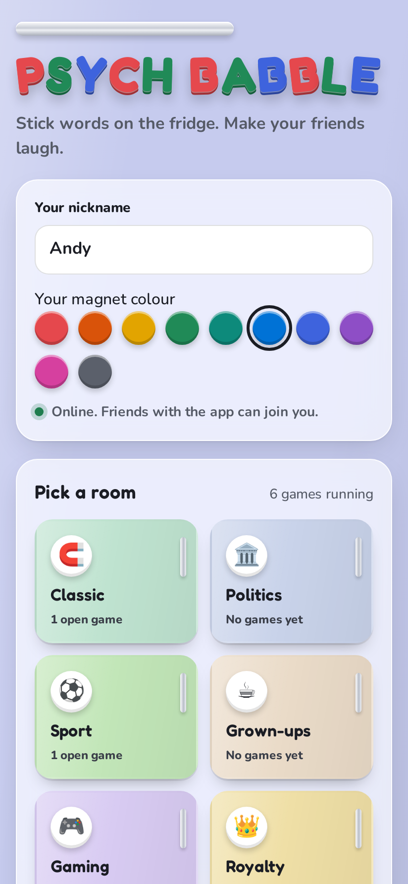
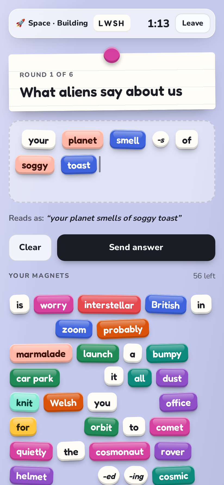
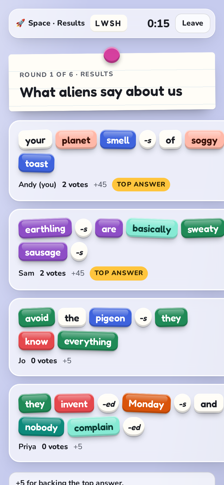
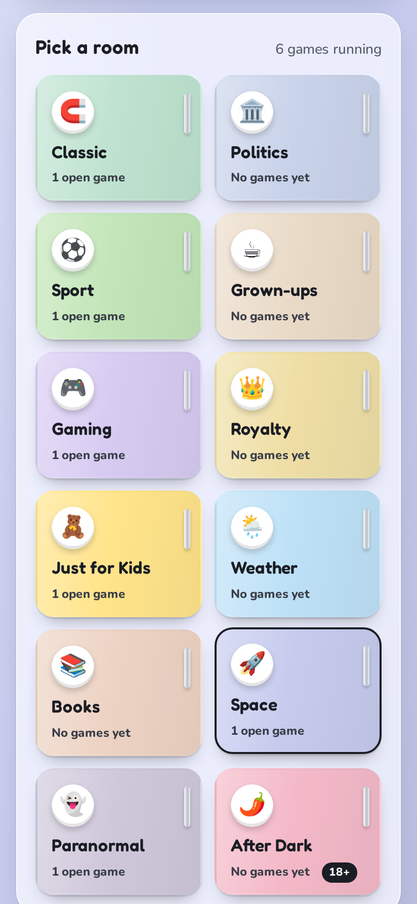
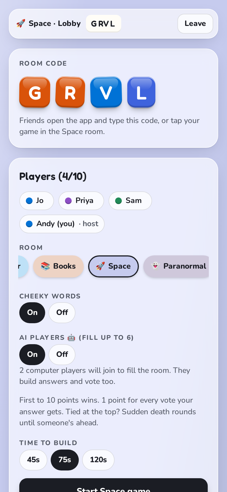
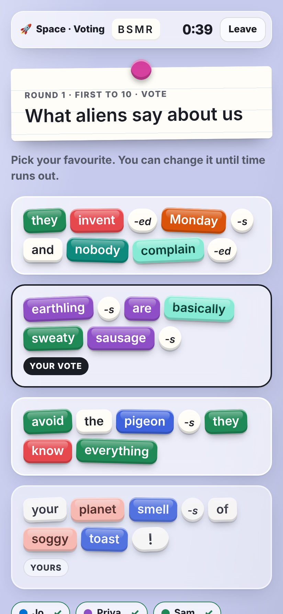
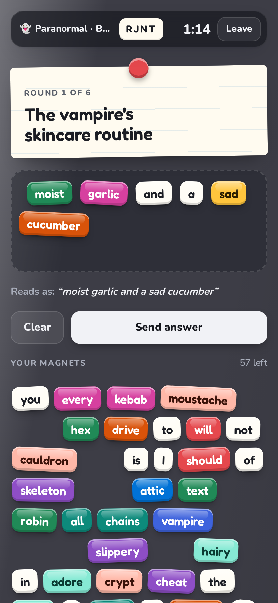
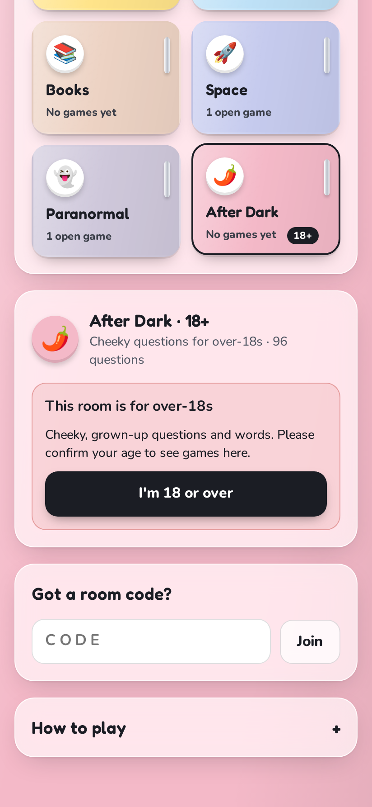

# Brain Jumble

**A fridge-magnet party game for Android phones.** Everyone gets the same silly question and the same pile of word magnets. You've got 75 seconds to stick together the funniest answer you can, then everyone votes, anonymously, for their favourite.

Brain Jumble is a fan-made revival of the much-missed online game *Psychbabble*, rebuilt so friends can play it again on their phones, from anywhere.

  
  
  

## Download and install

1. On your Android phone, open this repo's **[Releases](../../releases/latest)** page and tap **Brain Jumble (latest build)**.
2. Download `BrainJumble.apk` and open it.
3. If Android asks, allow installs from your browser ("Install unknown apps"), then tap **Install**.

New versions install straight over the old one, so updating is the same three steps. Everyone playing together should be on the latest version.

## How a game works

1. **Pick a room and start a game.** You get a four-letter room code. Friends type the code, or just tap your game in the same room on their home screen.
2. **Build your answer.** Everyone sees the same question and the same ~60 magnets. Tap magnets to stick them on your fridge.
3. **Vote.** All the answers appear without names. Tap your favourite. You can't vote for your own.
4. **See who wrote what.** Names are revealed with the votes, and the next round starts automatically. After the last round, the top scorer wins.

| Pick a room | Wait in the lobby | Vote for the best |
| :---: | :---: | :---: |
|  |  |  |

### Moving magnets around

- **Tap** a magnet in your pile to add it to your answer.
- **Drag** a placed magnet to move it.
- **Double-tap** a placed magnet, or drag it off the fridge, to put it back.
- **Tap a gap** between magnets to choose where the next word goes.
- The small round magnets (**-s**, **-ing**, **-ed**, **-ly**) stick onto the end of the word before them, so *dance* + *-ing* reads as "dancing".
- Changed your mind after sending? Tap **Edit answer** any time before the timer runs out.

### Scoring

| | Points |
| --- | ---: |
| Each vote your answer gets | 10 |
| Bonus for the round's top answer (ties share it) | 20 |
| Voting for the round's top answer | 5 |

### Host settings

Whoever starts the game is the host. Before starting, they can change the room, the number of rounds (4, 6, 8 or 10) and the building time (45, 75 or 120 seconds). If the host leaves, anyone else in the room can tap **Host this room** to carry on.

## Themed rooms

Each room has its own questions and its own magnets, mixed in with the general word bank. Altogether there are about **1,500 words** and nearly **400 questions**.

| Room | What it's like |
| --- | --- |
| 🧲 **Classic** | The original anything-goes mix |
| 🏛️ **Politics** | Manifestos, U-turns and leaky memos |
| ⚽ **Sport** | Half-time team talks and dodgy refs |
| ☕ **Grown-ups** | Bills, bosses, hangovers and adulting |
| 🎮 **Gaming** | Final bosses, lag and rage quits |
| 👑 **Royalty** | Crowns, corgis and court gossip |
| 🧸 **Just for Kids** | Silly, safe and family-friendly. Only ever deals kid-safe words |
| 🌦️ **Weather** | Drizzle, heatwaves and forecasts |
| 📚 **Books** | Plot twists and overdue library fines |
| 🚀 **Space** | Aliens, rockets and black holes |
| 👻 **Paranormal** | Ghosts, curses and things that go bump |
| 🌶️ **After Dark (18+)** | Cheeky, grown-up questions. Players confirm they're 18 or over first |

| Dark mode | The 18+ check |
| :---: | :---: |
|  |  |

The app follows your phone's light or dark setting automatically, and the fridge door changes colour to match the room you're in.

## Adding your own questions and words

Everything lives in [`www/words.js`](www/words.js):

- Each room in `ROOMS` has a `prompts` list (the questions) and a `words` list (that room's extra magnets).
- The general bank shared by most rooms is in `NOUNS`, `VERBS`, `ADJS` and `WILD`.
- For a magnet with more than one word, join the words with hyphens, like `ice-cream`. It shows on the magnet as "ice cream".

Edit the file on GitHub and commit. A new APK is built automatically within a few minutes, and the screenshots on this page refresh themselves too.

## How it's built

- **`www/`** is the whole game in plain HTML and JavaScript.
  - `www/index.html` holds the screens and game rules.
  - `www/words.js` holds the rooms, questions and word bank.
  - `www/net.js` connects players through Firebase.
- **Multiplayer** runs on Firebase Realtime Database, on the free plan. The host's phone runs the game and everyone else's phone follows along. Each player only writes their own answer and vote.
- **The Android app** is built by GitHub Actions (`.github/workflows/build.yml`). On every push to `main`, it wraps `www/` with Capacitor, builds the APK, and publishes it as the `latest` release.
- **The screenshots** are taken by `.github/workflows/screenshots.yml`, which plays a quick game in a phone-sized browser with three pretend friends.
- `signing/debug.keystore` keeps the signing key the same between builds, so updates install cleanly. It's a standard debug key, not a secret.

### Firebase setup (one time)

1. In the Firebase console, enable **Authentication → Anonymous**.
2. Create a **Realtime Database**, then paste the contents of `database.rules.json` into its **Rules** tab and **Publish**.
3. Put your web app config into `www/firebase-config.js`.

Without a Firebase config the app still runs, but only in solo practice mode.

## Credits

Inspired by the original Psychbabble. This is an unofficial fan remake made for playing with friends, and isn't connected to the original game or its makers.
